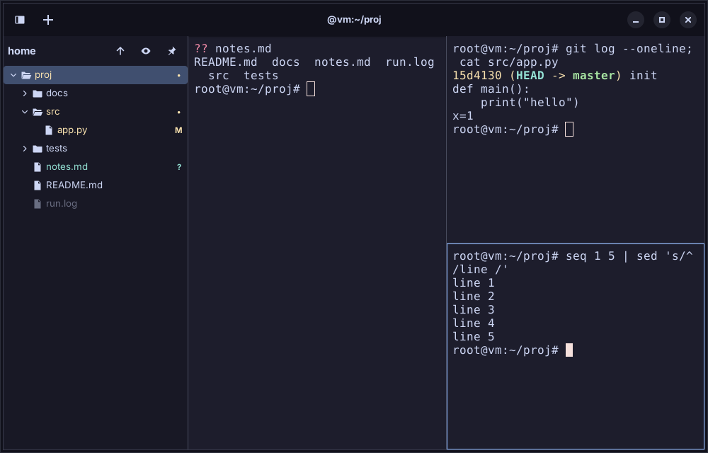
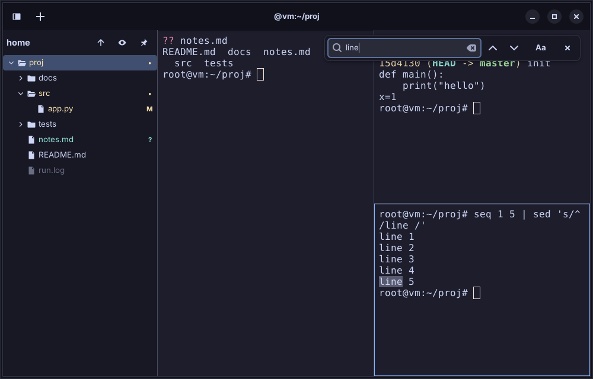
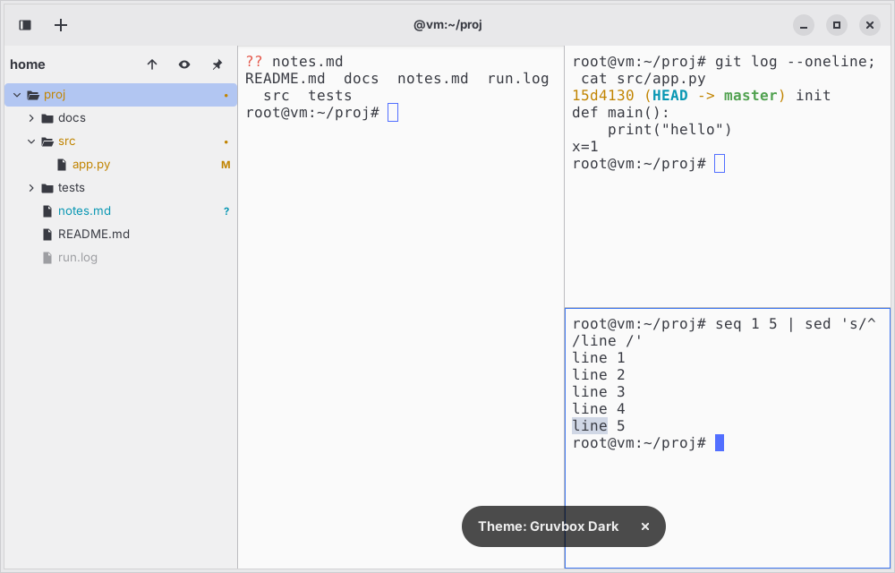

# paneterm

A good-looking Linux terminal emulator with fast pane splitting and a file tree sidebar.
Built on GTK4, libadwaita and VTE; Python 3.11+.

> **paneterm is a working title.** The name is defined in `paneterm/__init__.py` and
> `pyproject.toml` only, so renaming it later is a two-file change.

## Status

Built milestone by milestone from the development specification.

| Milestone | State |
| --- | --- |
| M1 Single terminal window | Done: themed window, VTE running your shell, copy/paste, config loading |
| M2 Splits and tabs | Done: nested splits, close/collapse, directional focus, resize, pane zoom, tabs, working-directory inheritance |
| M3 Config and themes | Done: five bundled themes, runtime switching, live config reload, system light/dark following, rebindable keys |
| M4 File tree sidebar | Done: lazy tree, follow mode and pin, live updates, icons, activation actions, context menu, keyboard navigation, filter |
| M5 Git integration and polish | Done: git status colors, `.gitignore` dimming/hiding, scrollback search, clickable URLs, font zoom, remembered window size |
| M6 Packaging | Done: launcher entry and icon (`--install-desktop`), install steps per distro, screenshots |

## Keybindings

All bindings use Ctrl+Shift or Ctrl+Alt, so they never collide with shell shortcuts.
They are remappable in `[keybindings]`.

| Action | Default |
| --- | --- |
| Split, new pane below (`split_down`) | Ctrl+Shift+O |
| Split, new pane to the right (`split_right`) | Ctrl+Shift+E |
| Close pane (`close_pane`) | Ctrl+Shift+W |
| Zoom / unzoom pane (`zoom_pane`) | Ctrl+Shift+Z |
| Move focus (`focus_left/right/up/down`) | Ctrl+Alt+Arrows |
| Resize pane (`resize_left/right/up/down`) | Ctrl+Shift+Alt+Arrows |
| New tab / next / previous | Ctrl+Shift+T / Ctrl+PageDown / Ctrl+PageUp |
| Jump to tab 1..9 (`goto_tab_1`..) | Alt+1..9 |
| Copy / paste | Ctrl+Shift+C / Ctrl+Shift+V |
| Cycle theme (`cycle_theme`) | Ctrl+Shift+P |
| Reload config (`reload_config`) | Ctrl+Shift+R |
| Search the scrollback (`search`) | Ctrl+Shift+F |
| Font zoom in / out / reset (`zoom_in/out/reset`) | Ctrl+plus / Ctrl+minus / Ctrl+0 |
| Show / hide sidebar (`toggle_sidebar`) | Ctrl+Shift+B |
| Focus the sidebar (`focus_sidebar`) | Ctrl+Alt+B |

Ctrl+= and the keypad's + / - / 0 also zoom. Ctrl+click opens a URL in the output.

If two actions end up with the same accelerator, a warning is logged and shown as a toast.

## Install

PyGObject, GTK4, libadwaita and VTE come from the distro, not from PyPI. Install those,
then paneterm itself with pipx, and add it to the application menu:

```sh
pipx install --system-site-packages .
paneterm --install-desktop      # launcher + icon for this user, no root needed
```

`--system-site-packages` is required so the isolated environment can see the distro's
`python3-gi`. pipx cannot install a launcher or an icon by itself, which is why
`--install-desktop` exists: it writes
`~/.local/share/applications/io.github.paneterm.Paneterm.desktop` and the icon next to it.
Log out and back in (or wait a moment) if the menu does not show it at once.

| Distro | Packages |
| --- | --- |
| Kubuntu / Ubuntu / Debian | `sudo apt install python3-gi gir1.2-gtk-4.0 gir1.2-adw-1 gir1.2-vte-3.91 librsvg2-common pipx` |
| Fedora | `sudo dnf install python3-gobject gtk4 libadwaita vte291-gtk4 librsvg2 pipx` |
| Arch | `sudo pacman -S python-gobject gtk4 libadwaita vte4 librsvg python-pipx` |

The Debian/Ubuntu line is the one that has been used (it installed and ran on Kubuntu
26.04 with Python 3.14); the Fedora and Arch names are from those distros' package lists and
are **not verified**. If `apt` cannot find a package, search with `apt search vte | grep -i gtk4`.
`librsvg2-common` provides the SVG loader the sidebar icons need.

### Update and uninstall

```sh
pipx install --system-site-packages --force .   # update from a checkout
paneterm --uninstall-desktop                    # remove the launcher and icon
pipx uninstall paneterm
```

Your settings stay in `~/.config/paneterm/` and `~/.local/state/paneterm/`; delete those
folders too for a clean removal.

### Run from a checkout (no install)

```sh
python3 -m paneterm             # from the project folder
python3 -m paneterm --debug     # with debug logging
python3 -m pytest               # the unit tests (no display needed)
```

paneterm is a single-instance application: starting it while it is running just brings the
running window forward, so an installed copy can answer a launch meant for a checkout.
Quit the installed one first.

Automated checks ran with GTK 4.14, libadwaita 1.5, VTE 0.76 and Python 3.12 under Xvfb.
Not yet tested on Wayland.

## Screenshots

Splits with the file tree (git status colors, an ignored file dimmed):



Scrollback search:



A light theme (`one-light`):



These were taken in a virtual display without a Nerd Font, so the terminal text uses the
fallback monospace font.

## Working directory tracking (OSC 7)

Split panes and the sidebar need to know each shell's current directory. VTE learns it
from the OSC 7 escape sequence, which not every zsh setup emits. Add this to `~/.zshrc`:

```sh
paneterm --print-shell-integration >> ~/.zshrc
```

The snippet percent-encodes the path, so directories with spaces or non-ASCII names work.
It is three lines rather than the one line the spec asks for; a plain one-liner produces
invalid URIs for such paths. Without it, paneterm falls back to reading
`/proc/<pid>/cwd`, which also works but cannot see through nested shells.

## Configuration

`$XDG_CONFIG_HOME/paneterm/config.toml` (default `~/.config/paneterm/config.toml`).
Every setting has a default, and a missing or partial file is fine. An invalid value
logs a warning, shows one toast, and falls back to its default; it never crashes.
User themes go in `~/.config/paneterm/themes/*.toml` and override bundled ones with the
same file name. `paneterm --help` lists the command-line flags.

```toml
[general]
shell = ""               # empty = $SHELL, then /bin/zsh, then /bin/bash
login_shell = true       # start the shell with -l
scrollback_lines = 10000
clickable_urls = true    # Ctrl+click opens URLs
search_case_sensitive = false
search_wrap_around = true

[window]
width = 1000
height = 640

[panes]
resize_step = 40         # pixels moved by one keyboard resize

[tabs]
autohide = true          # hide the tab bar while only one tab is open

[appearance]
theme = "catppuccin-mocha"
follow_system_scheme = false             # true: pick dark_theme or light_theme by the system
dark_theme = "catppuccin-mocha"
light_theme = "one-light"
font_family = "JetBrainsMono Nerd Font"   # falls back to FiraCode/Iosevka NF, then Monospace
font_size = 12
opacity = 0.95           # terminal background only, never the text
padding = 8
cursor_shape = "block"   # block | ibeam | underline
cursor_blink = false
zoom_scope = "pane"      # pane | window: what Ctrl+plus / Ctrl+minus resize
zoom_step = 0.1

[sidebar]
visible = true           # first-launch default; afterwards the remembered state wins
width = 260              # same
follow_cwd = true        # the root follows the focused pane's directory
show_hidden = false      # H toggles it while the tree is focused
hide_gitignored = false  # true hides ignored entries; false dims them (I toggles)
git_status = true        # color and mark changed files (needs git)
on_file_activate = "editor_split"   # editor_split | paste_path | desktop_open
on_dir_activate = "cd"              # cd | reroot
editor = ""              # empty = $VISUAL, then $EDITOR, then nano/vim/vi (may include arguments)
editor_split_direction = "right"    # right | down
reveal_in_root = true    # a cd inside the shown tree expands to it instead of re-rooting
indent = 16              # pixels per tree level

[keybindings]
copy = "<Ctrl><Shift>c"
paste = "<Ctrl><Shift>v"
```

Keybindings for actions that are not implemented yet (splits, tabs, sidebar, ...) are
accepted and validated but not bound until their milestone lands.

## File tree sidebar

Ctrl+Shift+B shows or hides it, Ctrl+Alt+B moves keyboard focus into it. Whether it is
visible and how wide it is are remembered in `~/.local/state/paneterm/state.json`, which
wins over `[sidebar] visible/width` (those are only the first-launch defaults). Your
config file is never rewritten.

- **Follow mode** (default): the tree follows the focused pane's directory, debounced
  by 150 ms. If the directory is inside the tree, it is expanded and scrolled to instead of
  re-rooting. The pin button locks the root for this window.
- **Live updates**: every expanded directory is watched; create, delete and rename events
  update the tree without a reload. Collapsing a directory releases its watchers.
- **Keys** (tree focused): Up/Down move, Right or `l` expand, Left or `h` collapse (or go
  to the parent), Enter open, `H` toggle hidden files, `/` filter by name, F2 rename,
  Delete move to trash, Menu or Shift+F10 context menu, Escape back to the terminal.
- **Mouse**: a click expands or collapses a directory; a double click activates it. Right
  click opens the context menu (copy path, copy relative path, reveal in file manager,
  new file, new folder, rename, move to trash, open in new tab).
- **Activation**: a directory runs `cd` in the focused pane, a file opens `$EDITOR` in a new
  split. The `cd` is only typed when the shell is at a prompt; otherwise a toast says what is
  running. Paths are shell-quoted.
- **Git** (inside a repository): changed files are colored and marked (`M` modified,
  `A` added, `?` untracked, `D` deleted, `!` conflicted); a directory shows `•` and the most
  important status of anything below it. Ignored entries are dimmed, or hidden with
  `hide_gitignored` (`I` toggles it for the session). Colors come from the theme's palette.
  `git` runs on its own thread with `GIT_OPTIONAL_LOCKS=0`, so it never blocks the window or
  takes the index lock, and it re-runs about 300 ms after files change, are saved, or after
  `git add` / `commit` / `checkout` in a shell. More keys: `p` pin, `-` or Backspace go to
  the parent, F5 refresh.
- **Icons** are bundled symbolic SVGs, so no glyph font is needed. They require the SVG
  pixbuf loader (`librsvg2-common`), which a desktop install already has.

## Themes

Bundled: `catppuccin-mocha` (default), `tokyo-night`, `gruvbox-dark`, `nord` and
`one-light`. **Ctrl+Shift+P** cycles through them, recoloring every pane, tab and the
window chrome at once. Set one permanently with `theme = "nord"`.

To add your own, drop a `.toml` file into `~/.config/paneterm/themes/` (the folder is
created on first start). Copy one of the bundled files from the installed package as a
template: `terminal` colors, a 16-entry `palette`, and `ui` colors for the chrome. A user
theme with the same file name as a bundled one replaces it. Theme files are reloaded
live, so you can edit one and watch it update.

With `follow_system_scheme = true`, `dark_theme` or `light_theme` is chosen by the
desktop's dark/light preference and changes when that does.

## Live reload

The config file and the themes folder are watched. Saving either applies the change to
all open windows and panes within a moment, including fonts, colors, opacity, padding,
the tab bar and keybindings. Ctrl+Shift+R reloads on demand.

- A mistake never breaks a running window: an invalid value, an unknown theme or broken
  TOML logs a warning, shows one toast, and uses the default for that value.
- A theme picked with Ctrl+Shift+P lasts until the config is reloaded or edited. While
  following the system scheme, cycling pauses the following until the next reload.
- Settings that only matter at creation (`shell`, `login_shell`, window size) apply to
  new panes and tabs, not to shells that are already running.

## Design decisions

Where the spec was ambiguous, the simplest behavior was chosen:

- **Login shell.** The shell is started with `-l` (FR-1 asks for a login shell). Set
  `login_shell = false` to turn that off.
- **TERM and COLORTERM.** Always set to `xterm-256color` and `truecolor` for the child.
  FR-2's "unless the user overrides them" has no config key yet, because inheriting TERM
  from whichever terminal launched paneterm would advertise the wrong capabilities.
- **Window size.** `[window] width/height` was added so there are no magic constants in
  widget code. Persisting the size between launches belongs to M5.

- **Light theme.** `one-light` rather than Catppuccin Latte: Latte's yellow and magenta fall
  below 2.5:1 contrast on its background. A unit test keeps every bundled theme readable
  (body text at least 7:1, colored ANSI entries at least 2.5:1).
- **Config folders.** paneterm creates `~/.config/paneterm/` and its `themes/` folder on
  startup (not the config file itself). Directories are watched instead of the file, so
  editors that save by renaming a temp file over it are handled.
- **Split naming.** `split_down` puts the new pane below, `split_right` puts it beside,
  matching Terminator. Inside the code these are `Axis.VERTICAL` / `Axis.HORIZONTAL`
  (GTK's orientation of the children), which is the reverse of the everyday wording.
- **Focus indicator.** `focus_indicator = "border"` draws a 1 px accent outline over the
  pane, so it never changes the pane's size. It only shows while several panes are visible.
- **Remote shells.** Inside `ssh`, the remote shell's OSC 7 reports its own path. A URI
  naming another host is ignored, so a new split opens in a local directory instead.
- **Close behavior.** Closing a pane sends its shell SIGHUP. There is no "confirm close
  while a command is running" prompt yet (`confirm_close_running` is parsed but unused).
- **Known cosmetic warning.** Closing a pane programmatically in an unfocused window can log
  a GTK `gtk_paned_set_focus_child` warning. It did not appear with real keypresses in a
  focused window, and has no visible effect.

- **Double click on a directory.** The first click already expanded it, so a double click
  expands and then `cd`s (or re-roots). It does not toggle twice.
- **Typed text at the prompt.** `cd` is typed after whatever is already on the command line,
  as the spec's idle check cannot see a half-typed line.
- **Unreachable root.** If the root directory disappears the tree moves to the nearest
  directory that still exists. A directory still open in a shell sends no delete event, so
  this is also checked once a second.
- **Filter** only applies to directories that are already loaded; it never scans the disk.
- **Git status and `.gitignore`** (`hide_gitignored`) arrive with M5.

- **Window size.** The size and maximized state are remembered in the state file and win over
  `[window] width/height`, which only set the first-launch size.
- **Search** uses VTE's own search: the match is highlighted and selected in the terminal.
  Enter / Shift+Enter go to the next / previous match, Escape closes the bar. The text is
  matched literally, not as a regular expression.
- **URL clicking** only opens `http`, `https`, `ftp(s)`, `file` and `mailto`, also for OSC 8
  hyperlinks, so a program cannot make Ctrl+click launch an arbitrary protocol handler.
  A trailing `.` `,` `)` is not treated as part of the link, so a URL that itself ends in
  `)` loses it.
- **Font zoom** is per pane by default; `zoom_scope = "window"` zooms every pane and new ones.

## Development

```sh
python3 -m pytest        # needs python3-pytest, or: pip install -e '.[dev]'
ruff check . && ruff format --check .
```

The config, theme, keybinding and shell-resolution modules do not import GTK, so their
tests run without a display. The pane tree (M2) will follow the same rule.
