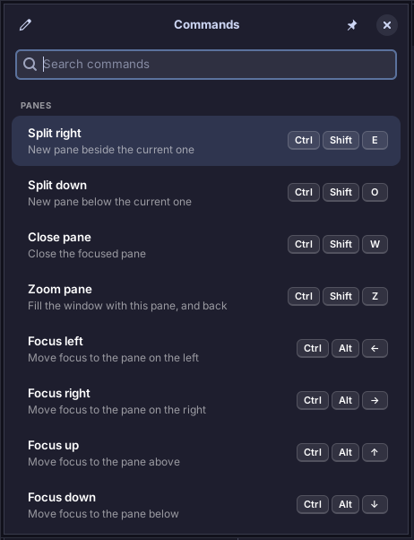
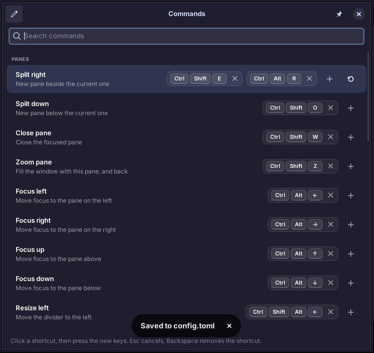

<h1 align="center">shellac</h1>

<p align="center">
  A good-looking Linux terminal emulator with fast pane splitting<br>
  and a file tree that follows you around.
</p>

<p align="center">
  
  
  
</p>


shellac is a terminal for people who live in splits. It is built on GTK4, libadwaita and
VTE, so it looks at home on a modern Linux desktop and behaves like the terminal you already
know, with a few things added.

## Features

- **Splits and tabs.** Nest horizontal and vertical splits like Terminator, move focus by
  direction, resize from the keyboard, zoom a single pane, and keep working directories when
  you split.
- **File tree sidebar.** A tree in the style of nvim-tree that follows the directory of the
  focused pane. Git status colors, language icons, live updates, filtering, rename, trash and
  a context menu, all from the keyboard or the mouse.
- **Git aware.** Changed, added, untracked and conflicted files are colored and marked, and
  ignored files are dimmed or hidden. Git runs off the main thread, so the window never stalls.
- **Themes.** Five bundled themes, runtime switching with one key, your own themes as plain
  TOML files, and optional following of the system light/dark setting.
- **Command palette.** A compact window listing every command with its shortcuts, searchable
  and runnable. The pen button makes the shortcuts editable: change one, add a second shortcut
  for the same command, or restore the default. Changes are written to `config.toml`.
- **Live configuration.** Edit `config.toml` or a theme and every window updates at once.
  A mistake never breaks a running window.
- **Search and links.** Search the scrollback with highlighting, and Ctrl+click URLs.
- **Configurable file actions.** Clicking a file can open your editor, run a command, run the
  file, paste its path or open it with the desktop, per extension if you like.
- **Remembers your layout.** Window size, sidebar visibility and width.

<details>
<summary>More screenshots</summary>

The command palette, compact and in edit mode:

 

Scrollback search:


A light theme (`one-light`):


</details>

## Install

shellac needs PyGObject, GTK4, libadwaita and VTE from your distribution (they are not on
PyPI), then installs with pipx.

**1. Install the system packages**

| Distro | Command |
| --- | --- |
| Kubuntu / Ubuntu / Debian | `sudo apt install python3-gi gir1.2-gtk-4.0 gir1.2-adw-1 gir1.2-vte-3.91 librsvg2-common pipx` |
| Fedora | `sudo dnf install python3-gobject gtk4 libadwaita vte291-gtk4 librsvg2 pipx` |
| Arch | `sudo pacman -S python-gobject gtk4 libadwaita vte4 librsvg python-pipx` |

The Debian/Ubuntu line is tested on Kubuntu 26.04. The Fedora and Arch package names come
from those distros' package lists and have not been verified; if one is not found, please
open an issue.

**2. Install shellac**

From a clone of this repository:

```sh
pipx install --system-site-packages .
shellac --install-desktop      # adds the launcher and icon for your user, no root needed
```

`--system-site-packages` lets pipx's isolated environment see the distribution's `python3-gi`.
`--install-desktop` is needed because pipx cannot install a menu entry or icon by itself. If
the entry does not show up in your application menu at once, log out and back in.

Then start it from the menu or run `shellac`.

### Update

```sh
git pull
pipx install --system-site-packages --force .
shellac --install-desktop
```

### Uninstall

```sh
shellac --uninstall-desktop
pipx uninstall shellac
```

Your settings live in `~/.config/shellac/` and `~/.local/state/shellac/`; delete those too
for a clean removal.

## Quick start

Everything uses Ctrl+Shift or Ctrl+Alt, so nothing collides with your shell's shortcuts.

| Action | Keys |
| --- | --- |
| Split: new pane below / to the right | `Ctrl+Shift+O` / `Ctrl+Shift+E` |
| Close pane | `Ctrl+Shift+W` |
| Zoom or unzoom the pane | `Ctrl+Shift+Z` |
| Move focus between panes | `Ctrl+Alt+Arrows` |
| Resize the pane | `Ctrl+Shift+Alt+Arrows` |
| New tab / next / previous | `Ctrl+Shift+T` / `Ctrl+PageDown` / `Ctrl+PageUp` |
| Jump to tab 1 to 9 | `Alt+1` to `Alt+9` |
| Copy / paste | `Ctrl+Shift+C` / `Ctrl+Shift+V` |
| Search the scrollback | `Ctrl+Shift+F` |
| Font zoom in / out / reset | `Ctrl+plus` / `Ctrl+minus` / `Ctrl+0` |
| Command palette (all shortcuts, editable) | `Ctrl+Shift+Space` |
| Cycle theme | `Ctrl+Shift+P` |
| Reload configuration | `Ctrl+Shift+R` |
| Show or hide the sidebar | `Ctrl+Shift+B` |
| Move keyboard focus to the sidebar | `Ctrl+Alt+B` |

Forgot one? Press `Ctrl+Shift+Space` for the **command palette**: it lists every command with
its shortcuts, filters as you type, and runs the selected command on Enter. It is a small
window you can leave open next to the terminal (the pin button keeps it open after running a
command). The **pen button** switches to edit mode: click a shortcut and press the new keys,
use **+** to give a command a second shortcut, **×** to remove one, or the circular arrow to
restore that command's default. The **Go to tab** row sets the modifier for tabs 1 to 9 at
once: press a modifier plus a digit, such as `Alt+1`.

Your edits are only a draft until you press **Save**, which writes them into `[keybindings]`
in your config file (nothing else in the file is touched). **Cancel** throws the draft away,
**Reset** puts every default shortcut back into the draft, and leaving with unsaved changes
asks first.

Shortcuts can also be remapped by hand under `[keybindings]` (see
[Configuration](#configuration)).

## The file tree

The sidebar shows the directory of the pane you are working in and follows you as you `cd`.
The pin button locks it to one place. Use the mouse, or press `Ctrl+Alt+B` to move into it:

| Key | Does |
| --- | --- |
| `Up` / `Down` | move |
| `Right` or `l` / `Left` or `h` | expand / collapse (or go to the parent) |
| `Enter` | open the file, or `cd` into the directory |
| `/` | filter by name |
| `H` | toggle hidden files |
| `I` | toggle hiding of git-ignored files |
| `p` | pin or unpin the root |
| `-` or `Backspace` | go to the parent directory |
| `F2` / `Delete` | rename / move to trash |
| `F5` | refresh |
| `Menu` or `Shift+F10` | context menu |
| `Esc` | back to the terminal |

To change the width, drag the divider, or press `Ctrl+Shift+Alt+Left/Right` while the tree
has focus. Git status uses `M` modified, `A` added, `?` untracked, `D` deleted and `!`
conflicted, with the theme's colors; directories show a dot if anything inside has changed.

What a click on a file does is configurable. The default opens `$VISUAL` / `$EDITOR` in a new
split. See [file activation](docs/configuration.md#sidebar-file-activation) for running a
command, running the file, or choosing the action per extension.

## Configuration

Settings live in `~/.config/shellac/config.toml`. Every setting has a default, so the file
can be tiny, or missing. A short example:

```toml
[appearance]
theme = "tokyo-night"
font_family = "JetBrainsMono Nerd Font"
font_size = 12
opacity = 0.95

[sidebar]
on_file_activate = "editor_split"   # or: editor_tab, command_split, run, paste_path, ...
file_type_icons = true

[sidebar.open_with]
sh = "bash {path}"

[keybindings]
split_right = "<Ctrl><Shift>d"
```

Saving the file applies the change straight away. The full list of settings, the theme
format and the live-reload rules are in the **[configuration reference](docs/configuration.md)**.

### Themes

Bundled: `catppuccin-mocha` (default), `tokyo-night`, `gruvbox-dark`, `nord` and `one-light`.
Press `Ctrl+Shift+P` to cycle through them. To make your own, put a `.toml` file in
`~/.config/shellac/themes/`.

### Fonts

shellac uses `font_family` from the config and falls back to common Nerd Fonts and then to
the system monospace font. For prompt themes with icons (Powerlevel10k, starship), install a
[Nerd Font](https://www.nerdfonts.com/) and set it as `font_family`.

## Shell integration

Splits and the sidebar need to know each shell's current directory. VTE learns it from the
OSC 7 escape sequence, which some zsh setups do not emit. If new splits open in the wrong
directory or the sidebar does not follow your `cd`, add the snippet to your `~/.zshrc`:

```sh
shellac --print-shell-integration >> ~/.zshrc
```

Without it, shellac falls back to reading `/proc/<pid>/cwd`, which also works but cannot see
through nested shells such as `ssh`.

## Troubleshooting

| Problem | Try |
| --- | --- |
| Icons in the sidebar are blank | install `librsvg2-common` (the SVG loader) |
| No menu entry after install | run `shellac --install-desktop`, then log out and back in |
| New splits open in `~` | add the [shell integration](#shell-integration) |
| Prompt shows boxes instead of symbols | use a Nerd Font as `font_family` |
| Starting it again does nothing | shellac is single-instance: it brings the running window forward |
| Want debug output | `shellac --debug` |

## Development

```sh
git clone https://github.com/ChristofferLjungAhlstedt/shellac.git shellac && cd shellac
python3 -m venv --system-site-packages .venv    # the system packages provide PyGObject
. .venv/bin/activate
pip install -e '.[dev]'

pytest -q                # unit tests, no display needed
ruff check .             # lint
python3 -m shellac       # run from the checkout
```

The configuration, theme, keybinding, pane-tree and file-tree model code does not import
GTK, so it is covered by plain unit tests. The window and widgets are checked by hand and with
scripted runs under Xvfb. If you installed shellac with pipx, quit it first, because a second
instance just raises the running one.

Design decisions, milestone history and testing notes are in
[docs/design-notes.md](docs/design-notes.md). The project follows these rules: the pane layout
is a plain data structure kept separate from GTK, nothing blocks the GTK main loop, every
user-visible setting is in the config file, and code is type-hinted and ruff-clean.

Known limits: not yet tested on Wayland; the optional "confirm before closing a running
shell" prompt is not built.

## License

shellac is free software under the **GNU General Public License v3.0 or later**; see
[`LICENSE`](LICENSE). Copyright (C) 2026 Christoffer Ljung Ahlstedt.

The file-type icons come from [Material Icon Theme](https://github.com/material-extensions/vscode-material-icon-theme)
(MIT) and the logos remain trademarks of their owners; see
[`THIRD_PARTY_NOTICES.md`](THIRD_PARTY_NOTICES.md).
